# Pinout and MIDI configuration

# Contents
1.  [Overview](#1-overview)
2.  [The Pinout and MIDI configuration page](#2-the-pinout-and-midi-configuration-page)
     * [Select pinout definition](#select-pinout-definition)
     * [Changing information in a pinout file](#changing-information-in-a-pinout-file)
     * [Transposition](#transposition)
     * [Available pins](#available-pins)
     * [Description](#description)
     * [Input and output ports](#input-and-output-ports)
         * [Neopixel LED](#neopixel-led)
         * [Microphone](#microphone)
         * [Crank rotation sensor](#crank-rotation-sensor)
         * [Start touchpad or start switch](#start-touchpad-or-start-switch)
         * [Tempo encoder](#tempo-encoder)
         * [Electronic registers](#electronic-registers)
     * [GPIO MIDI](#gpio-midi)
     * [MIDI note definition](#midi-note-definition)
     * [GPIO ports for RC servos](#gpio-ports-for-rc-servos)
     * [Servo pulse width and MIDI notes for RC Servos](#servo-pulse-width-and-midi-notes-for-rc-servos)
     * [I2C bus](#i2c-bus)
     * [MCP23017 port expander](#mcp23017-port-expander)
     * [PCA9685 RC servo driver](#pca9685-rc-servo-driver)
     * [MIDI output over serial communications](#midi-output-over-serial-communications)
     * [Registers](#registers)
3.  [How to make a new template](#3-how-to-make-a-new-template)
     * [Order of entries in the pinout file](#order-of-entries-in-the-pinout-file)
     * [Entry types](#entry-types)
     * [Description entry](#description-entry)
     * [Entries for neopixel, microphone, tachometer, rotary tempo encoder and I2C](#entries-for-neopixel-microphone-tachometer-rotary-tempo-encoder-and-i2c)
     * [Touchpad or start switch entry](#touchpad-or-start-switch-entry)
     * [Register entry](#register-entry)
     * [Entry for GPIO MIDI](#entry-for-gpio-midi)
     * [Entry for GPIO servos](#entry-for-gpio-servos)
     * [Entry for MCP23017](#entry-for-mcp23017)
     * [Entry for the PCA9685](#entry-for-the-pca9685)
     * [MIDI note entry](#midi-note-entry)
     * [MIDI note entry for RC servos (GPIO servos and PCA9685 servos)](#midi-note-entry-for-rc-servos-gpio-servos-and-pca9685-servos)
     * [How to upload a new pinout json](#how-to-upload-a-new-pinout-json)
     * [List pinout by MIDI note](#list-pinout-by-midi-note)
4.  [Copyright](#4-copyright)
# 1. Overview

The Pinout and MIDI configuration allows to:
* Define the inputs and outputs of the microcontroller, i.e. the functions assigned to each pin of the ESP32-S3 (hence the name "pinout")
* Select preconfigured pinout definition files
* Use the "Pinout and MIDI configuration" page to alter the contents of the preconfigured pinout definition files
* Define new pinout definition files, if the existing templates don't cover your needs

What inputs and outputs can be defined with the pinout:

Inputs:

* Touchpad, start switch
* Microphone (for tuner)
* Crank rotation sensor
* Tempo encoder for MIDI tempo
* Registers (electronic equivalent to organ stops)

Outputs: 
* Neopixel RGB LED
* All outputs for MIDI actuators:
* GPIO ports to drive solenoid actuators and the MIDI note assignment for these
* I2C bus and devices on the bus, namely MCP23017 to drive solenoid actuators, PCA9865 to drive RC servo motors, and the MIDI note assignment for these
* MIDI over serial output

The Pinout and MIDI configuration page is best used on a PC since it is rather wide.

In the literature, the "pins" are also called "ports", but here we are using "pins".


# 2. The Pinout and MIDI configuration page

## Select pinout definition
In this section, a list of pinout files that are available in the microcontroller is displayed.

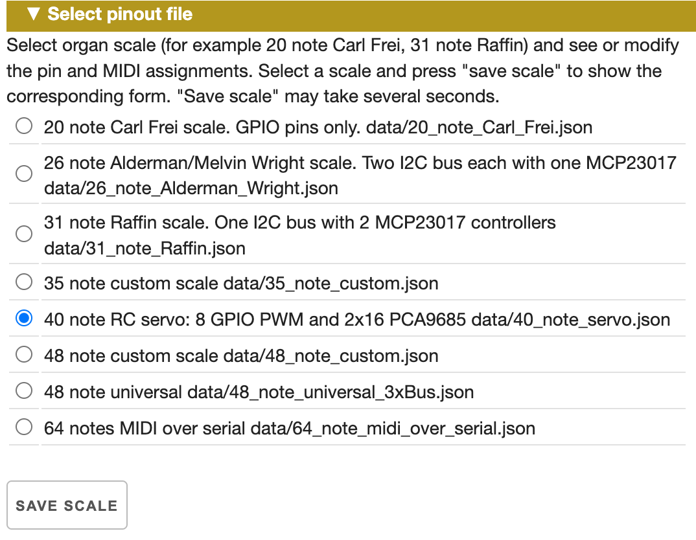

Select the one that corresponds to your hardware requirements and press "Save scale". The contents can be seen right away but the change takes effect for music playback after a reboot.

If none of the pinout definitions in the GITHUB repository fulfills your needs, you have two options:
* Post in the [GITHUB crank organ discussions forum](https://github.com/bixb922/crank-organ/discussions) describing your configuration and I will try to come up with a pinout.json
* See the [How to make a new template](#3-how-make-a-new-template) section here in this document.

## Changing information in a pinout file

Use the Pinout and MIDI configuration page to alter the contents of an existing pinout file. The page will show the input fields according to the structure of the pinout file. 

Unused entries in the pinout file need not be filled in and are then just ignored. There is no gain in trimming down a pinout file.

The information is ordered by hardware structure. If you want a view by MIDI note, use the "List pinout by midi note" at the end of the page.

Press the "Save Pinout Definitions" at the bottom of the page to save any changes. 

The contents will be validated before writing the result back.

The result is always written to the pinout file itself. There is no way to save to another file. The built-in backup mechanism will keep yesterdays version (and the day before yesterday) in the /data folder. Also, you can make backups to your PC with the File Manager.


## Transposition
You can transpose all notes in the pin definition up and down by semitones (half tones) to match your requirements. Press "Save Pinout Definitions" to save the change.

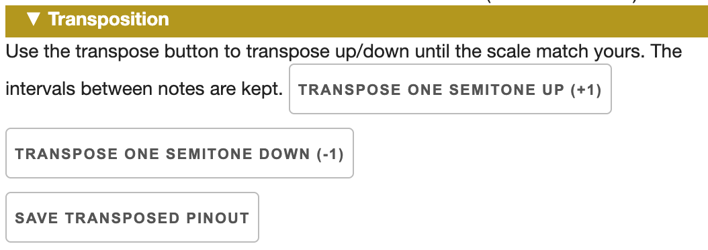

Please press "Save pinout definitions" button to save changes.

## Available pins

This section shows available, used and restricted pins on the microcontroller. This is an aid to learn what pins can be used for each function.

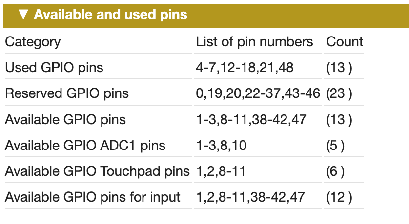

* Used GPIO pins: ESP32-S3 GPIO pins used for different functions in this pinout.
* Reserved GPIO pins: ESP32-S3 GPIO pins that cannot be used. These are described in the ESP32-S3 Technical Reference Manual and are also not available for MicroPython.
* Available GPIO pins: GPIO pins that still can be assigned a function in the pinout. These can be used for I2C, microphone and for MIDI output.
* Available GPIO ADC1 pins: Available pins that can be used as ADC (analog-digital converter) for the microphone. These are all in the ADC1 block. The ADC2 block pins cannot be used because they are taken by WiFi.
* Available GPIO Touchpad pins: Available pins that can be used for the touchpad function.
* Available pins for input: some otherwise available pins cannot be used for input, since they could stall the boot process. Crank sensor, rotary sensor or switches should use pins from these lists.

The restrictions described here are checked when the "Save pinout definition" button is pressed. So if you want to validate a GPIO pin assignment, select the pinout file and save it (no changes are necessary to force a validation).


## Description
This is one line text description of the pinout.


## Input and output ports

This section defines all ESP32-S3 GPIO input and output ports that are not related to MIDI output. 

It depends on the pinout json file which of the elements are really shown in this section. If a certain function does not appear in the Pinout and MIDI configuration page, you will have to make a new template, see [here](#3-how-make-a-new-template).

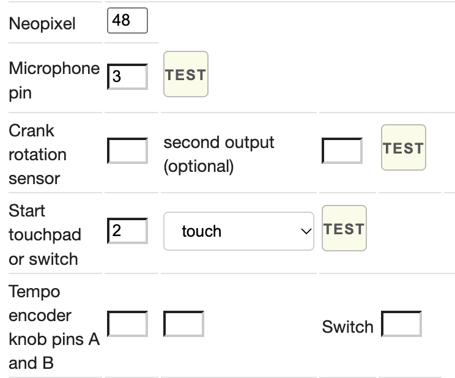

If you leave a input box blank, then that function will not be enabled.

Many definitions have a `TEST` button. These tests will stop after 30 seconds to 1 minute. 

If you change a pin number, the `TEST` button will work on the pin numbers just entered, not the saved ones. This allows for quick testing of different pins.

### Neopixel LED

The neopixel LED, also called RGB LED or WS2812 is normally included on the board of the ESP32-S3 (i.e. is part of the DEVKIT-C board). The neopixel LED is normally either at pin 48 or at pin 38. If in doubt, you can try with both values and then reboot, and see which works. Or check the schematics.

Sometimes the LED is disconnected and you need to solder a bridge on the DEVKIT-C board.

### Microphone

The tuner uses the microphone. This must be a ADC1 block pin, see [here](#available-pins).

The `TEST` button will show a real time graph of the sound captured by the microphone. Click `TEST`, then make some noise. The graph closes after some seconds.

If the microphone is not connected, this entry will probably show some noise, since the ADC inputs of the ESP32-S3 pick up electrical ambient noise, but shouting at the mic will not make those lines wiggle...

### Crank rotation sensor

The crank rotation sensor configuration has a detailed description [here](/doc-software/README.md#crank-configuration)

The `TEST` button will show the raw pulse count. Make exactly one whole turn and you will know the number of pulses to enter on the General Configuration page. Leave the crank without movement and the count will reset to zero. Once configured, the "System" page will also have a button to show a crank sensor "revolutions per second" graph.


### Start touchpad or start switch

The "start touchpad" or "start switch" (or both) start the top MIDI file in the setlist.

The "start touchpad" must be one of the touchpad enabled pins of the ESP32-S3, see [here](#available-pins). Select "touch".

The "start switch" can be connected to any available input GPIO pin of the ESP32-S3. Select "switch to GND".

Also see [switch and touchpad](/doc-hardware/README.md#11-switch-instead-of-a-touchpad-to-start-the-music)
and [Use a metallic knob as touchpad](/doc-hardware/README.md#metallic-drawer-knob-as-touch-pad)

There is a `TEST` button to see if the switch or touchpad is working.

For the touchpad, it will show the ESP32-S3 reading of the touchpad input. The values may be around 30000 for "not being touched" and around 150000 for "being touched". Your values may vary. They depend on the mass of the knob used and the air or skin moisture. The important value here is the difference between the two readings. Record the difference between "on" and "off" state. There is a value on the General Configuration page that can be set to a value that has to be clearly lower than that difference. 

For the switch, it will show the state of the switch for some time.

### Tempo encoder

See [here](/doc-hardware/README.md#rotary-sensor-potentiometer-type-to-change-tempo) for details on what the rotary tempo encoder is and [here](/doc-software/README.md#rotary-sensor-to-change-tempo) for details of its definition.

You need to input the two pins for the rotary encoder. Optionally you can also enter the switch that resets the tempo to "normal".

To change the rotation direction, inerchange the two rotary encoder pins.

### Electronic registers

See [Registers](#registers)

## GPIO MIDI

The GPIO MIDI section defines output pins for actuators such as solenoids connected to GPIO pins. 

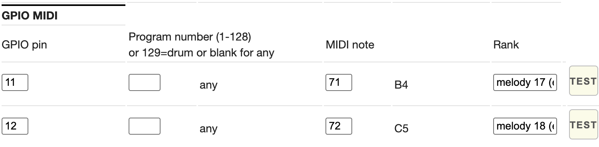


*GPIO pin*: 

This is the GPIO pin that outputs the signal to turn the solenoid on or off. Each GPIO pin may appear once only. 
You now indicate which MIDI note in a MIDI file will trigger this pin.

**CAUTION:** The output pins of the ESP32-S3 cannot drive solenoids (electromagnets) directly. The current they supply is not enough, and solenoids produce very high current pulses when turned off that must be absorbed with a "kick back diode". These pulses would destroy the ESP32-S3 outright. Always connect the GPIO output to a driver such as the ULN2803A or ULN2003A, which will amplify the current and provide the kick back diodes. See [ULN2803A wiring](/doc-hardware/README.md#wires-for-uln2803-output-to-solenoid-screw-terminals) for more information.

## MIDI note definition

This definition is common to all output pins (or ports) that trigger a MIDI note.

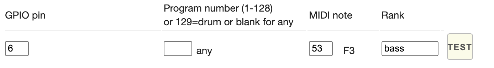

The first column is the "pin number", in this image "GPIO pin". This will vary according to the device, and may be "MCP pin", "PCA pin" or even "Row number" depending on the context.

The pin number cannot be changed here. If you really need to change the pin number, see [How to make a new template](#3-how-make-a-new-template). Editing the pinout file to change pin numbers is not difficult. It is the first number after "midi" in each entry. Be sure to follow [these instructions](#how-to-upload-a-new-pinout-json) to install the changed pinout file: 


*Program number:* 

* If left blank, the program number (instrument) of the MIDI note may be any, i.e. it is disregarded. This is useful in MIDI configurations where the crank organ has only one type of pipes, because the MIDI file can have any instrument (piano, organ, etc) and the note will sound. This is also called "wildcard program", since any program will match the MIDI note.
* A number 1 to 128 will indicate a MIDI program number. Fill in the program number, and when you leave the field, the GM instrument name will appear. See the [Wikipedia General MIDI article](https://en.wikipedia.org/wiki/General_MIDI) section "Program change events" for a complete list.
* The number 129 is a special instrument number that indicates that the MIDI note that will be defined here will match if played on channel 10, i.e. if thisis a percussion/drum instrument. The number 129 cannot appear in a MIDI file, it is only used here as an indicator.

In other words, there are three ways to define a MIDI note here:
* Only the MIDI note number, leaving program number blank or zero. This will match any MIDI program number in the MIDI file. This is the most common way to define notes, since for simple organs there is only one voice or instrument, and the program number in the MIDI file does not matter.

* Program number and MIDI note number. The output port will activate only if the specified program number and MIDI number is encountered. This is necesary to implement, for example, a glockenspiel or reed pipes with their own actuators. A sliding register to switch air flow does not need program numbers.

* Program number 129 and MIDI note number. The output port will activate if the MIDI note number is encountered on the percussion channel 10  The program number 129 is not part of the MIDI standard and is only used here to define drum/percussion/channel 10 sounds.

*MIDI note:*

This is the MIDI note, from 1 to 127. 60 is C4 or "middle C"). If left blank this line is disregarded. The note C2 (MIDI number 0) cannot be used.

A MIDI note, or a pair program number/MIDI note may appear on several pins. This is allowed. If that MIDI note or program/note pair appears in a MIDI file, all defined outputs will be activated.

*Rank*

Insert a description here where the pipe (or whatever device it is you are sounding) is located, for example: "2nd row position 4" or "Windchest 2 front row 3rd pipe". This description will appear on pages such as the tuning pages and allows to locate the pipe easily. Can be left blank.

*TEST*

This test button will turn the actuator connected here on and off several times. It allows you to locate the actuator, and test if it is correctly connected. 

This definition is allows to correct by software if a wiring got wrong. Instead of swapping wires, you just input the correct MIDI number that activates that output.

Unlike the tuner page, multiple `TEST` button clicks are not queued but done simultaneously. You can press a new button before the current solenoids stop moving.

For RC servos, the MIDI note definition has also an up and down button to the right of the `TEST` button:

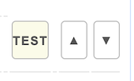

These buttons will adjust the "Off" position of the servo in small increments. This allows to adjust the "Off" position of the servo to the correct position. You will have to use the "Save pinout definitions" to make these changes permanent.

On power on, all RC servo motors will return to the "Off" position.


## GPIO ports for RC servos

Up to 8 GPIO ports can be allocated for RC servos. Any of the available GPIO ports can be used for RC servos.

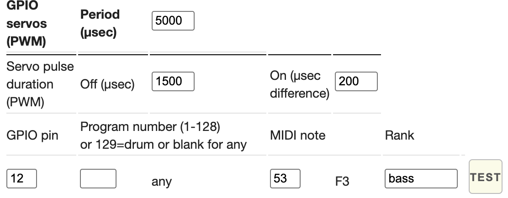

These GPIO ports can be connected directly to the input port of a 3.3V compatible RC Servo. Note that some RC Servos need a 5V signal, so a 3.3V to 5V level shifter is needed (this voltage is independent of the RC servo supply voltage, which is typically somewhere 4.8V and 8V depending on the servo.)

If you need more than 8 RC servo ports, add a PCA9685.

*GPIO servos (PWM)	Period (μsec)*

This is the period in microseconds between one RC pulse and the next, i.e. the interval between a refresh of the position of the RC servo. The typical value is 20000 microseconds (20 milliseconds). Analog RC Servos need 20000 but some digital RC servos work with faster pulse rates and react much faster, so there is a benefit in defining a faster refresh rate. The lowest possible value for a digital servo is in it's specs. It is often called "frame period", "signal period" or "refresh period".
 
This definition is common to all GPIO servo output ports. You can define groups of GPIO output ports with a different refresh rate altering the pinout file, see [How to make a new template](#3-how-make-a-new-template). There are some ESP32-S3 restrictions here however.

## Servo pulse width and MIDI notes for RC Servos

This is a definition that is done for each MIDI note.

*Servo pulse duration (PWM)	Off (μsec)*

This is the servo pulse width, in microseconds, for the "off" position. Normally the range for this is between 1000 and 2000, but some servos allow 500 to 2500.

*On (μsec difference)*

When adding this to the "Servo pulse duration (PWM)	Off (μsec)", then this yields the pulse width for the "on" position of the servo. This sum should not exceed the range allowed by the servo, i.e. 1000 to 2000 (or 500 to 2500).

The value can be positive (for one direction of rotation) or negative (for the opposite direction of rotation).

With a typical servo arm, 200 microseconds causes a movement of 3 to 5mm, which may be enough to move the device. Try to use the smallest value that still works, because the smaller the value, the faster the movement.

See also this document [RC servos for crank organ valves](/doc-servo/servos.md).

The servo pulse duration applies to the following [MIDI note definition](#midi-note-definition).


## I2C bus

See this [Wikipedia article](https://en.wikipedia.org/wiki/I2C) for a description what a I2C bus is and how it works.

A I2C bus is defined with this entry:


*SDA*

The GPIO pin number of the SDA pin (I2C bus data).

*SCL*

The GPIO pin number of the SCL pin (I2C bus clock). SCL is the same as SCK, both names mean the same thing.

The software uses the so-called SoftI2C interface of MicroPython that allows any number of I2C buses. The ESP32-S3 limit of 4 hardware I2C buses does not affect the SoftI2C buses.

*TEST*

The test button will perform a I2C bus scan and return all addresses detected on the I2C bus. 

If your device does not appear on the scan, verify if SDA and SCL pins are accidentally swapped. Also, check if the SDA and SCL lines have pull-up resistors. Check if the I2C device is powered up and connected.

If very many devices appear on the scan, then the bus is wired incorrectly. 

Following the I2C header there can be one or more MCP23017 or PCA9685 device definitions. Within the same I2C bus, device addresses must be unique. Following each MCP23017 or PCA9685 device definition, there are always 16 [MIDI definition entries](#midi-note-definition) numbered from 0 to 15, one for each pin on the device.

## MCP23017 port expander

The MCP23017 entry only needs to define a I2C bus address for this device:
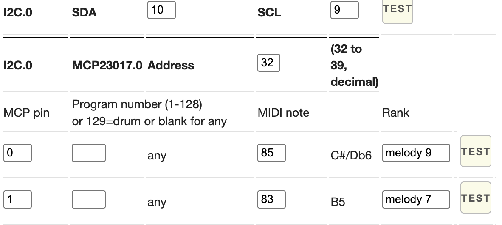

The address is in decimal notation and must be between 32 and 39 (hexadecimal 0x20 and 0x29). The address must match the address jumpers on the MCP23017.

There is no special test button for the MCP23017 but you can scan if the I2C responds.

Following the MCP23017 header, you will find 16 entries to define the MIDI notes that will trigger each of the MCP23017 outputs.

## PCA9685 RC servo driver

This entry allows to define the setup for a PCA9685 RC Servo driver board connected to the I2C bus:

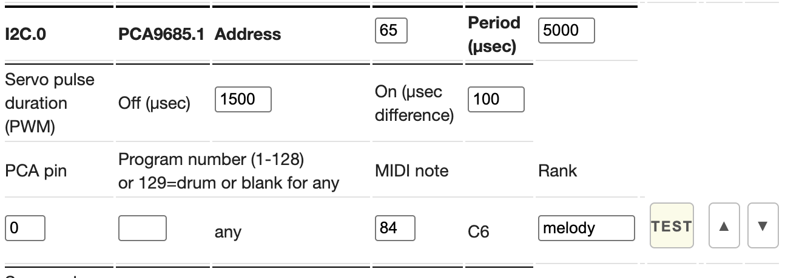

*PCA9685.n	Address*

This entry allows to define the PCA board's address on the I2C bus. Addresses are written in decimal and must be between 64 and 127 (hexadecimal 0x40 and 0x7f). The addresses must be unique in a given I2C bus. The address must be equal to the definition in the soldered address jumpers of the PCA board.

*Period (μsec)*

This is the period in microseconds between one RC pulse and the next, i.e. the interval between a refresh of the position of the RC servo. The typical value is 20000 microseconds (20 milliseconds). Analog RC Servos need 20000 but some digital RC servos work with faster pulse rates and react much faster, so there is a benefit in defining a faster refresh rate.
 
This definition is common to all output ports of the PCA9685.

What follows now are 16 entries where the MIDI notes and their servo pulse widths are defined. These have the same structure as GPIO RC Servos, see [Servo pulse width and MIDI definition](#servo-pulse-width-and-midi-notes-for-rc-servos).

See also this document [RC servos for crank organ valves](/doc-servo/servos.md).

## MIDI output over serial communications

The MIDI over serial entry defines the characteristics of a MIDI output port like the ones that have a 5 pin DIN connector. See here for details [How to connect an ESP32-S3 to MIDI over serial (MIDI over 5 pin DIN plug) ](https://github.com/bixb922/umidiparser/blob/master/midi_over_serial/midi_over_serial.md).

All MIDI notes defined within this header will be transmitted over the MIDI serial output, but also see the passthrough option below.

*UART (1-2)*

The ESP32-S3 can have 2 UART ports (i.e. serial ports). Enter the port number, can be 1 or 2.

*GPIO txpin*

This is the GPIO pin that is the MIDI output. Any available GPIO pin can be used.

*Output MIDI channel (1-16)*

If specified, then all MIDIs defined here are sent with the channel number set to the number here, disregarding the number that they have in the MIDI file. This is useful for some boards.

*UART RX (unused)*

This must be any available GPIO port. It is not used, but UART devices on the ESP32-S3 must have a RX (data received) pin.


*Passthrough*

If this is specified, all MIDI notes that are *not* specified elsewhere in the pinout definition will be sent to the MIDI serial output. Also, all channel messages (program changes, control changes, aftertouch, polytouch) and the SYSEX messages in the MIDI file are forwarded to the MIDI serial output. No change is made to the event, so channel number, velocity, etc are as defined in the MIDI file.

This is useful, for example, to drive a synthesizer for sounds that are not played by physical pipes.

For the MIDI notes defined in the "MIDI over serial" section, the pin number has no meaning, but it must be present. See this file: /data/64_note_midi_over_serial.json for an example.

## Registers

An electronic register allows to switch a set of pipes on and off with a single switch or using the web interface. It works just like a organ stop or sliding register, but needs a valve for each pipe.

If the register switch is turned on, all pipes associated with that register will be active and can be played. If it is off, that set of pipes will be silent.

See [Hardware section on registers](/doc-hardware/README.md#10-registers).

See [Software section on registers](/doc-software/README.md#registers).


Overview: you use a ["register"] entry to define the GPIO input ports where a register switch is connected. Every MIDI note now accepts the the register name that must be active to make that note sound. This also requires to have several MIDI entries per pin, one for each register.

Registers do not have a test button. The register status appears on the bottom of the Performance page.

If you are planning to use registers, please post in the discussion section and I will complete this section.

# 3. How to make a new template

A pinout file is a [JSON file](https://en.wikipedia.org/wiki/JSON). There are several pinout files in the `/data` folder of the crank organ repository.

The file contains the same data you see on the Pinout and MIDI configuration page.

Pinout files must be in the /data folder of the microcontroller and must have a name with these components:
* Number of notes, e.g. 20 or 31
* `_note_`
* A descriptive name
* `.json`

For example: `20_note_Carl_Frei.json`. If the file name doesn't follow this pattern, it will not be recognized. Once copied there, it will appear in the Pinout and MIDI Configuration page listed together with the other pinout files present.

The JSON format must be followed strictly. There are several online JSON validators available, that will show if the format is correct. Use white space and new lines to make the JSON file more readable for you. Text strings can contain "international characters" such as ä or ñ and must be enclosed in quotes ("). Numbers are all integers, can have sign. There are some `true` or `false` values there. Values are separated by commas. Keys have a colon (:) after the key.

JSON files can be edited with any text file editor such as Notepad or Notepad++ on Windows or TextPad on Mac (or even `vi` on Unix).

The pinout file structure is exactly the same as you will see on the Pinout and MIDI Configuration page. The fields are also the same, in the same order as the page.

Look at the different JSON files to see what they contain, and select them in the Pinout and MIDI Configuration page to see their content explained.

At the outermost level, all entries are enclosed in a pair of brackets `[]`.

Inside these brackets is a list of entries, each in turn delimited by brackets `[]`, for example:
```
[
["description", "3 note demo scale."],
["neopixel", 48],
["touchpad", 5],

["gpio"],
    ["midi",  6, "", 53, "bass"],
    ["midi",  7, "", 58, "bass"],
    ["midi", 15, "", 60, "bass"]
]
```
## Order of entries in the pinout file
The order of the entries is important. The first entry should be "description"

Then "neopixel", "tachometer",  "touchpad", "microphone", "tempo", "register" (the specific order here is not relevant)

Now comes each section for MIDI definition, by device type. If not needed, the section can be omitted.

"gpio" for GPIO MIDI for actuators such as solenoids, followed by it's MIDI definitions

"gpioservo" for GPIO MIDI for RC Servos, followed by it's MIDI definitions

"I2C" for each I2C bus. On each I2C bus, the devices on the bus (MCP23017, PCA9685) followed by their MIDI definitions. Like this:


Graphically, the structure should be like this. You can use indenting to show the nesting in the JSON file:

```
|-- description
|-- neopixel
|-- tachometer
|-- touchpad
|-- microphone
|-- tempo
|-- register
|-- gpio
|-----MIDI entry for GPIO output ports
|-----MIDI entry for GPIO output ports
|-----...
|-- gpioservo
|-----servopulse for next MIDI entry
|-----MIDI entry for GPIO output ports
|-----servopulse for next MIDI entry
|-----MIDI entry for GPIO output ports
|-----...
|--i2c entry for first I2C bus
|----mcp23017 entry for first MCP23017 on the first bus
|-------MIDI entry for MCP23017
|-------MIDI entry for MCP23017
|-------...
|----mcp23017 entry for second MCP23017 on the first bus
|-------MIDI entry for MCP23017
|-------MIDI entry for MCP23017
|----pca9685 entry
|-------servopulse for next MIDI entry
|-------MIDI entry for GPIO output ports
|-------servopulse for next MIDI entry
|-------MIDI entry for GPIO output ports
|-----...
|--i2c entry for second I2C bus
|----pca9685 entry for first PCA on second I2C bus
|-------servopulse for next MIDI entry
|-------MIDI entry for GPIO output ports
|-------servopulse for next MIDI entry
|-------MIDI entry for GPIO output ports
|-----...
|----pca9685 entry for second PCA on second I2C bus
|-------servopulse for next MIDI entry
|-------MIDI entry for GPIO output ports
|-------servopulse for next MIDI entry
|-------MIDI entry for GPIO output ports
|-----...
|----mcp23017 entry for first MCP23017 on second I2C bus
|-------MIDI entry for MCP23017
|-------MIDI entry for MCP23017
|-------...
...etc for more I2C buses and devices ...
```
Entries that are not used can be omitted. For example if there are no GPIO Servos, omit that section altogether. For example, if there are no I2C buses, omit that section and everything below that level.

## Entry types
Here is a short description of each entry type with an example:

## Description entry
```
["description", "3 note demo scale."],
```
Only two elements, the second is a text.

## Entries for neopixel, microphone, tachometer, rotary tempo encoder and I2C
```
 ["neopixel", 48],
 ["microphone", 10],
 ["tachometer", 1, 2],
 ["tempo", 40, 38, 47],
 ["i2c", 11, 12],
```
To leave a pin number blank, use "" and it will be ignored for example:
```
 ["microphone", ""],
 ```
Or else, delete the entry altogether.

"tachometer" is the entry for the crank sensor. `["tachometer", 1, ""]` will set up a counter on pin 1. `["tachometer", 1, 2]` will set up a quadrature encoder on pins 1 and 2. See [Crank rotationsensor](#crank-rotation-sensor) for more information.

"tempo" is the entry for the rotary encoder to set tempo. `["tempo", 40, 38, 47]` will set up GPIO pins 40 and 38 for the quadrature encoder part of the rotary encoder and pin 47 for the switch of the rotary encoder. If no switch is connected put a "" as third parameter. See [Tempo encoder](#tempo-encoder) for more information.

## Touchpad or start switch entry
This defines a touch pad connected to GPIO pin 9:
```
 ["touchpad", 9, 1],
```

This defines a switch connected to GPIO pin 9:
```
 ["touchpad", 9, 2],
 ```
 You can have both entries present. They must be on different GPIO pins.
```
 ["touchpad", 9, 1],
 ["touchpad", 10, 2],
 ```
 

## Register entry
```
 ["register", 41, "Bourdon", false],
```
The parameters are:
* GPIO port where the register switch is connected
* Name
* State at startup. true means "on", false means "off". The state of the register at startup does not depend on the switch but on this definition. 

## Entry for GPIO MIDI
```
 ["gpio"],
```
No parameters.

## Entry for GPIO servos
```
["gpioservo", 5500],
```
The parameter is the RC period (time between pulses) in microseconds.

## Entry for MCP23017
```
 ["mcp23017", 32],
```
The number is the address, in decimal. There must be a "i2c" somewhere before this entry.

## Entry for the PCA9685
```
[ "pca9685", 64, 5000],
```
First value is address, the second value is the period in microseconds between pulses. There must be a "i2c" somewhere before this entry.


## MIDI note entry

```
["midi", 0, "", 85, "melody pos 8", ""],
```
The parameters are:
* The pin number (what it means depends on where this is used, if used after ["gpio"] it is the GPIO pin number, if used after ["mcp23017",32] it is the MCP port number).
* The program number, 1 to 128, 129 for drums, "" to match any instrument in the MIDI file.
* The MIDI note number, 1-127, in this example: 85
* The "rank", a description of the location of the pipe, in this example "melody pos 8".
* The register name of the register that must be active to activate this pin. See section on [Registers](#registers). Leave to "" if no registers are used.

## MIDI note entry for RC servos (GPIO servos and PCA9685 servos)
Each note should have 2 entries:

```
["servopulse", 1500, 1800 ],
["midi", 0, "",  68, "melody" ],
```
The "servopulse" entry has two values: pulse width for "off" position, pulse with for "on" position, in microseconds.

Note that this *differs from the Pinout page* where the second value is the *difference* that has to be added to the "off" value, not the "off" value itself.

The "servopulse" entry applies to all following MIDI definition entries. It is more convenient to have one "servopulse" entry per MIDI note.
 

## How to upload a new pinout json

Upload the new pinout json file using the File Manager.  Verify that it goes to the `/data` folder.

Reboot the microcontroller.

Now open the Pinout and MIDI configuration page. The new (or changed) file should be in the "Select pinout file`" section. Select the new file (If not, then most probably the name doesn't follow the convention, e.g. 31_note_raffin.json)

Now press the "Save pinout definition" button at the bottom of the page. This will force a complete validation. Any problem, such as duplicate uses of GPIO pins, or use of reserved etc should appear here.

## List pinout by MIDI note

This button at the end of the page lists the currently saved content of the page ordered by MIDI note. This view allows to detect missing note definitions. It is also essential when defining registers.

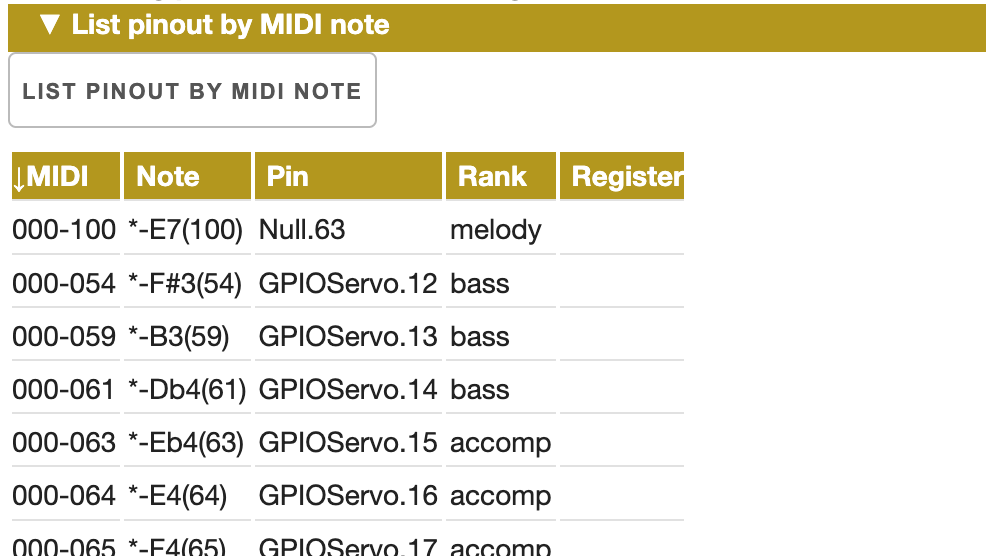

# 4. Copyright
(c) 2026 Hermann Paul von Borrie
